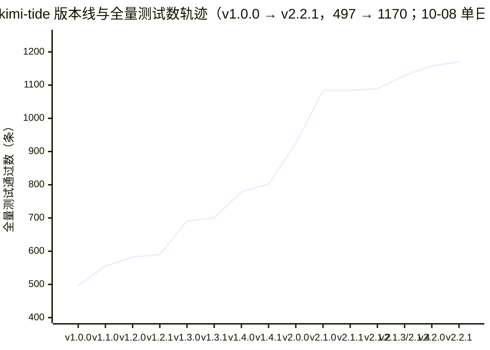
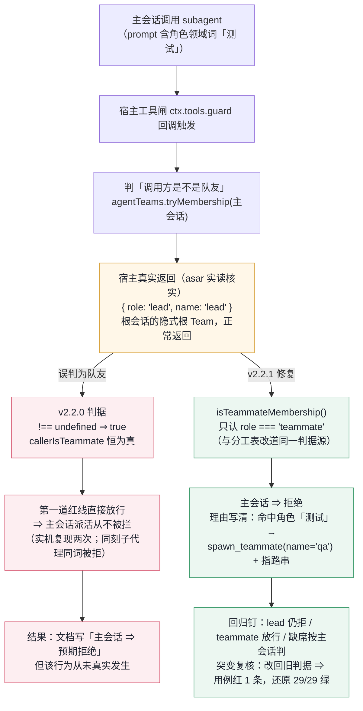
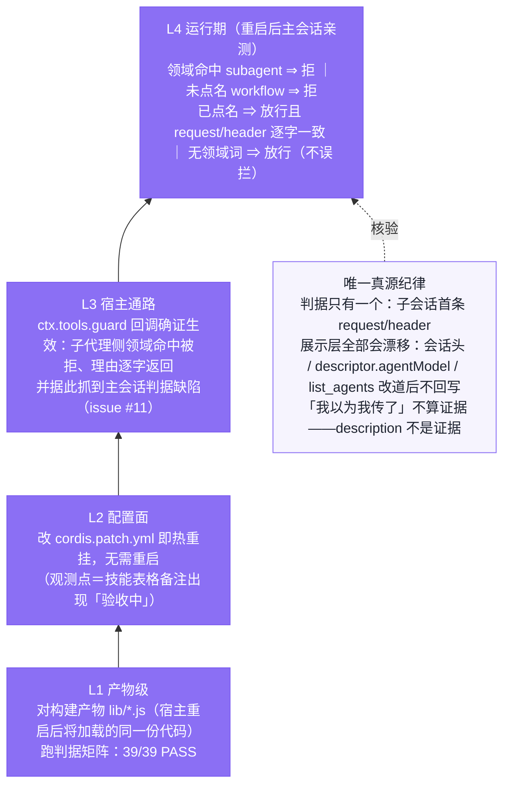
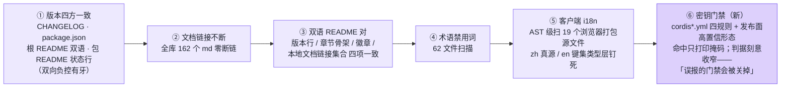

# kimi-tide（月汐）追踪研究 II：从「选模型」到「会编排」——分工层、派发护栏与质量操作系统的成形（v1.0.0–v2.2.1）

> **研究对象**：GitHub 开源项目 [tafcear/kimi-tide](https://github.com/tafcear/kimi-tide)（月汐）——DeepSeek Harness（DSH）生态中按步骤自动选模型的路由插件，及该项目自身实践并文档化的「双模型协作开发闭环」方法论。本篇为 2026-08 首篇研究（《架构、损耗与可行性》[^9^]）的**纵向追踪**，覆盖区间 v1.0.0（2026-08-29）→ v2.2.1（2026-10-09），约 40 天、16 个发布版本。
>
> **作者**：[tafcear](https://github.com/tafcear)（kimi-tide 项目作者）× Kimi（AI 研究协作）
> 研究基准日：2026-10-09 ｜ 项目最新发布：**v2.2.1（2026-10-09）** ｜ 前作存档：见本仓 `archive/`

## 摘要

首篇研究完成时，kimi-tide 刚发布 v1.0.0：一个 per-step 粒度的规则驱动路由器，外加一套文档化的双模型协作闭环。四十天后追踪到 v2.2.1，项目的形状发生了三次实质性变化。其一，**定位轴迁移**：对外叙事从「省钱」整体重写为「按模型强项编排工作流与各路代理」，省钱降为顺带结果——这不是文案调整，而是能力现实（多 provider 候选池、分工表、派发护栏）对旧叙事的追认[^1^][^8^]。其二，**功能面长出分工层**：v2.0.0 的「角色即路由」（分工表、主驱动恒定、派发台账、运行时技能卡）把路由从「主会话每一步」扩展到「派出去的每一步」，v2.1.0 再以五档决策链与统一路由表（`routes`，v7）完成信息架构统一[^1^][^6^]。其三，也是本研究着墨最多的——**质量面形成了一个可命名的「质量操作系统」**：六条机器门禁、双语四段式 Release 门禁、发布核验制度化（资产 sha256 与 API digest 逐字比对）、以及升格为发版前提的实机验收 runbook[^2^]。

这一周期提供了一个教科书级案例：**v2.2.0 交付的派发护栏对主会话完全不生效**——判据把宿主给根会话的 `{role:'lead'}` 误当成队友，「调用方是不是队友」恒为真，护栏对它唯一的设计对象零拦截；单测全绿、文档写着「主会话 ⇒ 预期拒绝」，但该行为从未真实发生。缺陷由 v2.2.1 的实机验收抓到并修复（issue #11[^7^]），同周期另有两处「单测绿但实机失效」的接入层缺陷（v2.0.0）。三类缺陷全部位于「插件假设 × 宿主真实行为」的接缝上——本研究据此提出核心论点：**插件架构中单元测试的有效半径止于宿主边界，接入层语义的唯一裁判是运行期判读与持久真源核对**。项目自己的应对——把「唯一判据＝子会话首条 `request/header`」写成纪律、把验收仪器自身的假通过/假阳性也当缺陷修——构成了一套可移植的验证方法论[^4^][^5^]。

---

## 1 追踪范围、材料与方法

本追踪覆盖 v1.0.0（2026-08-29，497/497 测试）至 v2.2.1（2026-10-09，1170/1170 测试、62 个测试文件）之间的 16 个发布版本[^2^][^6^]。材料全部为一手：仓库 CHANGELOG（版本历史唯一事实源）、`docs/release-evidence.md`（维护者证据链：commit 锚点、Actions run 号、资产 sha256、npm shasum）、派发护栏设计说明（`dispatch-guard.md`，含八条已知限制与逐字拒绝文案）、两份实机验收 runbook（`team-dispatch-acceptance.md` 的 A1a–A8 与 G-1–G-5 两期判据表）、协作闭环方法论文档（`agent-collaboration-loop.md`，新增 §3.6 派发后核验与 §5.1 派活机制选型判据），以及 v2.2.0–v2.2.1 区间的全部提交记录[^1^][^2^][^3^][^4^][^5^][^6^]。

与首篇相同，本研究按项目自己的证据纪律转述内部事实：版本号、测试计数、验收结论均以仓库文档原文为出处；文档中标注「未验/未执行」的条目，本研究一律按「未通过」处理而非采信设计意图。这一处理原则在 v2.2.0 护栏案例中被证明是正确的——详见第 6 章。

## 2 演进全景：四十天，十六个版本

| 版本 | 日期 | 主线 | 质量门（测试数） |
|---|---|---|---|
| v1.0.1 | 08-31 | 文档全面重写（3 秒看懂/10 秒看懂）；版本一致性闸 + 断链闸进 CI | （文档版）[^6^] |
| v1.1.0 | 09-04 | **评审流认领语义**：关键词组被评审流认领后不再劫持整轮路由，轮末异步评审出卡 | 555/555[^2^] |
| v1.2.0 | 09-11 | **会话事件解耦**：面板数据退出会话日志（终结 12 万条/200+MB 膨胀）；启动级 E2E；Release 双语四段门禁首跑即拦下一次不合规发版 | 582/582[^2^] |
| v1.2.1 | 09-11 | 设置页模型目录通道换道 `session/modelCatalog`（宿主 0.1.5 移除旧通道致 DeepSeek 整组消失） | 590/590[^2^] |
| v1.3.0 | 09-15 | 用量/余额全源覆盖（订阅窗/余额/三态「没数据」）；说明页；**语义命中确认闸**；`@provider/model` 精确寻址与 `@` 误判面收窄 | 691/691[^2^] |
| v1.3.1 | 09-28 | 适配宿主 0.1.7：`settings.register` 移除，配置改住插件条目配置；`agent/created` 短路隐患修复 | 700/700[^2^] |
| v1.4.0 | 10-03 | **评审闭环**：「干不好退回重做」成真（自动修订默认关/手动一键退回/复检默认开/每会话上限 1–3 次）；桌面端 0.2.0-rc.2 适配 | 779/779[^2^] |
| v1.4.1 | 10-03 | 档位下拉恒灰修复（旧通道返回空表**覆盖**真表）；评审模型补档位 | 802/802[^2^] |
| **v2.0.0** | 10-06 | **分工层执行面**：分工表（roles）＋主驱动恒定＋派发台账＋分工表注册为运行时技能卡 | 925/925[^2^] |
| **v2.1.0** | 10-08 | **路由信息架构统一**：五档决策链＋统一路由表 `routes`（v7）＋文案 locale 化（600 键 × 2 语言）；路由行为零变更 | 1084/1084[^2^] |
| v2.1.1 | 10-08 | 验收回填版（无功能变更）；B-4 写通道双写复跑 exit=0 | 1084/1084[^2^] |
| v2.1.2 | 10-08 | dock 悬浮层「自身滚动被当成页面滚动」修复（判据来自 Chromium 真机实测） | 1089/1089[^2^] |
| v2.1.3 | 10-08 | 显示名疑似密钥即拒绝落盘（12 组前缀 + 长随机串判据）；反馈入口三落点 | 1129/1129[^2^] |
| v2.1.4 | 10-08 | 包 README 补齐（此前两轮只升状态行、正文停在 v2.1.1）；版本闸三方扩四方 | 1129/1129[^2^] |
| **v2.2.0** | 10-08 | **派发护栏**（dispatchGuard，默认关）＋角色领域词 keywords；README 定位换代（编排轴）；npm 上架 | 1158/1158[^2^] |
| **v2.2.1** | 10-09 | **护栏判据修复**（对主会话零拦截，issue #11）＋拦截扩到 `workflow`＋「派完怎么验」＋密钥门禁（门禁五→六条） | 1170/1170[^2^] |

三点全景观察。**第一，节奏结构**：40 天里呈「酝酿—爆发」两段——9 月以 1.1–1.4 四段功能线稳步推进，10-03 起一周内连发 10 版（v1.4.0→v2.2.1），其中 10-08 单日 6 版；爆发段的每个版本都保持「测试绿 + typecheck 0 + 门禁全过 + 实机验收 + 发布核验」的全套质量门，说明提速来自流程自动化（Actions 发版流水线、门禁脚本）而非质量让步[^2^]。**第二，测试规模近乎线性翻倍**：497（v1.0.0）→1170（v2.2.1），新增约 673 条，且增量大量投向「负控」与「回归钉」——门禁与修复都要求「先红后绿」的自造夹具证明有效性[^2^]。**第三，发布物的可信度被制度化**：每个版本的 Release 资产都经「下载件 sha256 与 API digest 逐字比对、包内文件数与版本号核对」后才回填证据链；正是这套制度在 v2.2.0 当场抓住了 npm 与 GitHub 两渠道的 CRLF/LF 差异（详见第 8 章）[^2^]。

## 3 定位轴迁移：从「省钱」到「编排」

首篇研究记录的 kimi-tide 叙事核心是成本：「便宜的跑日常，厉害的攻难关」。v2.2.0 同批的 README 重写（commit `3397d46`）把首屏整体换到「**按模型强项编排工作流与各路代理**」轴：主定位句变为「把『这一步用哪个模型』变成你能编排的东西」，「它给你三样东西」改写为「三件事」——每个模型只干最擅长的那一步、派出去的活也按角色走、不用记着切回来；评审、省钱、面板收进「顺带还有」[^1^]。提交记录对动因的记载很坦率：新定位来自 DSH 官方讨论帖 #9169 的定位讨论[^8^]，而旧 README「前半段（省钱轴）与后半段（分工表/派发护栏，编排轴）不是一批写的——护栏那笔刚把后半段写实，头部还停在旧轴」[^1^]。

这次迁移值得单独记录，因为它示范了**工具叙事应当跟随能力现实而非锁定首发场景**。首篇研究已指出「项目已超出双模型范畴」（全量候选池、GLM/qwen 实机入池、多 plan 配额）[^9^]；到 v2.2.x，「Kimi × DeepSeek 双模型省钱器」的叙事已无法覆盖产品事实——分工表让任意模型按角色编排、护栏让派发纪律可强制执行、五档决策链覆盖显式指令到默认目标的全部路径。省钱没有消失，但从「卖点」降级为「编排正确后的自然结果」：README 场景三里「顺带的结果：省钱」一句话带过[^1^]。同期配套动作（hero 素材换品牌紫、架构图重制为 v2.1.x 形态、挂 npm 徽章）说明这是一次有完整交付意识的定位换代，而非顺手改文案[^2^]。

## 4 分工层执行面：角色即路由（v2.0.0）

v2.0.0 是功能面最重要的一版：路由的作用域从「主会话每一步」扩展到「派出去的每一步」。机制四件套[^1^][^6^]：

- **分工表（`roles`）**：一个角色 = id + 标签 + 目标模型；**队友名即认领键**——用角色 id 或别名建队友，月汐把该队友的每一步请求改道到角色目标；未被认领的队友一律不动，且子代理轮默认不被任务描述里的关键词二次改道。
- **分工表进模型视野**：路由开启且分工表非空时，分工表注册为运行时技能卡 `kimi-tide-team`——主模型派活前能自己读到「哪个角色用哪个模型、两种派发配方（一次性 `workflow` / 常驻队友 `spawn_teammate`）、队友名合法性」。表变更后存活会话的技能卡下一轮自动换新。**这一步把路由纪律从用户配置延伸进了模型行为**——派发决策由模型做出时，模型看得到规则。
- **主驱动恒定（`driver` + `driverSticky`）**：主会话默认目标钉在「主驱动」上，预设默认不再接管未命中轮；关键词规则与显式 `@` 照样赢。「最快的驱动、最强的干活」这一编排范式由此成为一等配置。
- **派发台账**：每次派发记依据（`role`/`unclaimed`/`explicit`/`keep`）、队友、角色标签、**最终生效**模型与时间，每父会话留 20 条；角色目标不可用时**不静默换人**——保持继承值并在面板逐字写明「「〈角色名〉」目标不可用 → 保持继承（〈实际生效目标〉）」。

配置工程延续「默认往返相等」红线：四个新字段全部可选、不带默认值、运行期按字段判据而非版本号门控，v5→v6 迁移留档 `.pre-v6`[^6^]。但真正有研究价值的是本版实机验收抓到的**两个接线层真缺陷**——两者单测全绿、实机失效[^2^][^4^]：

1. **服务探测静默失效**（`c54b2b3`）：宿主框架（cordis）对**未声明 inject 的服务访问即抛错**，而旧代码用「属性访问 + try/catch」探测可选服务——异常被吞成 `undefined`，于是分工表技能与队友查表**双双静默失效**，验收判据 A2/A4/A8 全废。修复改用框架提供的「不带依赖声明读取」通道，且刻意不把可选服务写成必需依赖（否则未装对应组合包的 profile 直接加载不了插件）。
2. **台账按错误维度收口**（`ed0e065`）：派发台账原按**子代理 id** 清理，而子代理「干完即销毁」——刚写进父会话面板的那一行立刻被删，派发区永远是空的。改为按**父会话**收口。

这两个缺陷与 v2.2.0 的护栏缺陷同属一族（详见第 9 章的归纳）。验收面，A1a–A8 八条判据全绿；唯一未执行项 P1（角色改道 × 带图锁存的组合）因宿主 GUI 的队友会话没有图片附件通道而「形态受限」，runbook 如实标注「**不得以未执行为由视为通过**」，代码侧由护栏单测兜底[^4^]——这条措辞后来成为项目验收纪律的标准句式。

## 5 信息架构的统一：五档决策链与一张路由表（v2.1.0）

v2.0.0 之后，配置面出现两个各管一半的体系：关键词规则（只服务主会话）与分工表（只服务队友）。用户视角的「冲突」实际是**作用域不分**的产物。v2.1.0 的解决是一次纯信息架构手术——「路由决策语义零变更」被写进版本标题[^6^]：

- **五档决策链**：显式 `@` ＞ 调用方点名 ＞ 分工表 role ＞ 关键词规则 ＞ 默认目标，与运行期优先级链逐档对齐；每档三行（触发条件/当前取值/关闭后的影响）+ 三态徽标（已就绪/按需/未启用）。默认目标档显式渲染并写明来源（主驱动恒定/预设默认/跟随宿主默认）；规则为空时渲染说明而非空表。
- **统一路由表 `routes`（配置 v7）**：两类行合成一张带 `scope` 的表——`session` 行（带 `preset` 归属）与 `dispatch` 行（带 `label`/`teammate`/`aliases`/`note`）。**`routes` 存在即真源**，旧字段保留为镜像（可回退、可 diff）；写通道是**三笔序列**（先摘 `routes` → 写旧字段 → 写回 `routes`）——宿主对每一笔都跑新旧一致性校验，中间态不合法则编辑永远落不了盘，「顺序是硬约束而不是风格」；`routes` 与镜像不一致（含**顺序分叉**）时写入期拒绝并指出冲突位置，不静默择一[^1^][^6^]。
- **作用域徽标与重叠解释**：规则行标「主会话」、角色行标「派发时」；同一个词既是规则对象又是角色身份词且两边目标不同时，两侧各挂一条**解释条而非报错**——「设计使然：主会话说『代码』走 A；派给『后端』做走 B」，并附两个一键动作（规则跟随该角色/词并入该角色别名）。
- **文案 locale 化**：600 键 × 2 语言，zh 为唯一真源，en 键集用 `Record<keyof typeof zh, string>` 在类型层钉死；新增 AST 级门禁 `check-client-i18n` 扫 18 个浏览器打包源文件的硬编码文案[^6^]。

值得记录的工程细节是「**独立交叉复核**」的建制化：v2.1.0 的健壮性修正（读路径畸形容错、镜像与校验缺省口径对齐、v5 文档带 `routes` 不再被迁移链静默抹掉、`activePreset: null` 时如实写「不发生任何改道」等）来自「同日、两个不同厂商的模型互审」后的 1 严重 + 10 中等全修[^6^]。首篇研究的「异质审查者命中认知盲区」命题，在此周期已从方法论沉淀为发版流水线的固定工位。

## 6 派发护栏：一个「从未生效」的机制的完整生命周期（v2.2.0 → v2.2.1）

本章是本追踪的核心案例。它完整展示了一个安全机制从「设计正确、测试全绿、文档齐备」到「实机从未生效」再到「验收抓出、修复、结清」的全部环节，每个环节都有留档。

### 6.1 缺口与设计（v2.2.0）

分工表的改道是**被动**的：`resolveRoleDecision()` 只认 `membership.role === 'teammate'`，而宿主对一次性子代理（裸 `subagent`/`subagent_fork`、`workflow` 的 `agent()`）不返回队友身份——于是「把前端活派给裸子代理」在结构上不可能被分工表改道，只会在默认模型上跑完，角色一次都不参与，且没有任何提示[^3^]。缺口的发现方式尤其值得记录：**它不是猜出来的，是插件自己说过的话引出来的**——分工表注入给模型的技能正文曾写「派发给对应模型的子代理」，照做的模型必然落进缺口；文档与实现相反，是缺口的直接成因[^3^]。

护栏的设计语义五件套：宿主 `ctx.tools.guard` 上的**单调最终拒绝**（一票否决，只能拒绝、不能自动改派）；**默认关闭**（不开启时行为逐字节不变）；绝不抛异常、畸形实参一律放行；调用方是队友时不拦；判据「宁可漏拦不可误拦」[^3^]。拒绝理由是模型面向文本，一次写清命中了谁、正确的下一步（`spawn_teammate(name="<角色 id>")`）、不该归它时怎么办。v2.2.0 发布时，CHANGELOG 如实挂账：「**护栏的运行期拒绝路径未验**——它是宿主侧接入，须重启宿主后在真实会话里判读」[^6^]。

### 6.2 缺陷：判据对它唯一的设计对象恒为真

2026-10-09 的实机验收（v2.2.1 发版前的欠账结清轮）抓到阻断级缺陷（issue #11[^7^]）。实测现象（同配置、同角色词，只换调用方）：**主会话**派命中角色领域的 `subagent`——放行，子代理照常跑完（复现两次）；同一时刻**子代理**发出的同词派发——被拒绝，理由逐字返回[^4^]。护栏注册、`ctx.tools.guard` 通路、角色匹配、拒绝文案全部正常；坏的只有「调用方是不是队友」这一个判断。

根因：接入代码用 `agentTeams.tryMembership?.(executor) !== undefined` 判队友；而宿主（`dsh-experimental-agent-team` 的 roster.js，经桌面端 asar 实读核实）对**没有父会话的根会话（＝主会话）返回 `{role:'lead', name:'lead'}`**——这是隐式根 Team 的正常返回，不是异常[^3^][^4^]。于是 `callerIsTeammate` 恒为 true，护栏对它唯一的设计对象零拦截。**该缺陷自 v2.2.0 起存在；设计文档自查步骤 3 原本就写「主会话 ⇒ 预期拒绝」——文档要的行为从未生效**[^4^]。

修复：新增导出纯函数 `isTeammateMembership()`（只认 `role === 'teammate'`，与分工表改道同一判据源）；回归钉钉进接入级测试（`{role:'lead'}` 仍拒 / `{role:'teammate'}` 放行 / 服务缺席按主会话口径判）；Lead 自造突变复核——把接入改回 `!== undefined`，新用例红 1 条，还原后 29/29 绿[^2^][^4^]。

### 6.3 扩面：设计上的出口被真实事故击穿（workflow 分支）

v2.2.0 曾把 `workflow` 留在拦截范围之外，口径是「`agent()` 带显式目标，是设计上的出口」[^3^]。**这个出口在 10-08 被一次真实事故击穿**：一个主会话用 `workflow` 派 3 个「独立评审」子代理，脚本写 `agent(prompt, { label, phase, schema })` 没传 `provider`/`model`，3 个子代理全部跑在默认目标 `deepseek-flash` 上——而派发说明写着「三个不同模型各一视角」。事后查明：改道判断做过、也做对了，但**没有任何一步的动作叫「核对路由」**[^5^]。

v2.2.1 据此扩面：`workflow` 脚本含 `agent(` 且全文没有词边界级 `provider`/`model` 任一 ⇒ 拒绝；拒绝理由一次写清四件事（会全跑默认目标/分工表与关键词规则为何不参与/两条改法/显式写默认目标即放行）。判据刻意做成词级启发式，「宁可漏拦不可误拦」——脚本里出现 `model` 一词（哪怕只是提示词正文）即视为点过名[^3^][^6^]。

### 6.4 两期验收与结清

验收分两层两期，全部留档[^4^]：

| 层 | 判据 | 结果 |
|---|---|---|
| G-1 产物级 | 对**构建产物**（`lib/*.js`，宿主重启后将加载的同一份代码）跑判据矩阵 | 39/39 PASS |
| G-2 配置面 | 改 profile 文件即热重挂，无需重启 | ✅（观测点＝技能表格备注出现「验收中」） |
| G-3 通路 | 宿主 `ctx.tools.guard` 通路确实生效 | ✅（子代理侧被拒）＋ **据此抓到 §6.2 缺陷** |
| G-4 文案 | 拒绝理由含命中角色、正确下一步、备选 | ✅（逐字留档） |
| G-5 运行期（重启后） | 领域命中 `subagent` ⇒ 拒；未点名 `workflow` ⇒ 拒；已点名 `workflow` ⇒ 放行且子会话 `request/header` 与点名目标逐字一致；无领域词 `subagent` ⇒ 放行（不误拦） | ✅ 四项全过 |

唯一未现场执行项是「队友自己派活 ⇒ 不拦」——理由是 roster 名额不可回收，「不为验收占用不可回收的资源」，由接入级单测 + 2026-10-06 A2/A8 的队友改道实机证据覆盖，并如实标注[^4^]。这种「验收伦理」——不为了打勾而消耗不可逆资源、用替代证据并明示覆盖关系——与「未执行不得视为通过」一体两面，是这套验收文化成熟的两端。

终态：用户裁定**护栏常开**（`router.dispatchGuard: enforce` 长留 profile），v2.2.1 发布，证据链回填（npm `latest` 约 2 分钟传播为 2.2.1，资产 sha256 与 API digest 逐字一致）[^2^]。

## 7 验证方法论的硬化：唯一真源与仪器的自我校验

护栏案例的副产品是一套显式成文的验证方法论，写进了协作手册 §3.6「派发后核验（必做）」[^5^]：

- **唯一判据**：子代理跑在哪个模型上，只有子会话**首条 `request/header` 事件**靠得住（宿主持久真源）。会话头、`descriptor.agentModel`、`list_agents` 在改道后不回写（展示层漂移），照它们判会判错；派发说明（description/label/phase）只是意图不是事实——「**我以为我传了**不算证据」。
- **工具化**：`scripts/acceptance/check-dispatch-routing.mjs <父会话 id> [--expect …]` 按父会话列出每个子会话实际跑的模型，退出码即结论；「整批落默认目标」被文档化为「`agent()` 没传 provider/model」的典型指纹。
- **使用纪律也文档化**：`--last N --expect` 的窗口在父会话活跃派发时可能跨批次（实测子会话数一轮里从 12 涨到 19），报「不一致」可能只是时序——「先确认派发结束再跑」写进了手册。

更罕见的是**验收仪器自身的缺陷也被同等对待**。10-08 一笔提交（`eaebe4e1`）修了三个验收工具的三类问题：① `check-routes-dualwrite.mjs` 的 parseArgs 静默忽略未知参数，`--profile web` 被无视、照旧读默认 profile 并**报 PASS**——假通过；② `routing-view-preview.mjs` 同类参数纪律问题；③ `prepush-coherence.mjs` 把 v1.3.0 的 7 条特性硬编码在源里，导致每个后续版本必然**假阳性**[^1^]。修法是白名单参数（未知参数 exit 2）、版本从 package.json 自适、特性清单按版本外置。这与首篇记录的「测试期望本身有误，测试也要被调试」一脉相承[^9^]——**仪器也要被验收**，否则会话级的「绿灯」只是仪器失灵。同类还有 `session-dump` 只认 v3/v0 会话文件而宿主已升 v4 导致「验收仪器对新会话全面失效」的修复[^1^]。

## 8 门禁与发布工程：质量操作系统的成形

到 v2.2.1，仓库门禁从首篇记录的五条扩为**六条**：①版本四方一致（CHANGELOG/包版本/根 README 双语/包 README 首屏状态行的版本号与日期——后者正是 v2.1.2/v2.1.3 两轮「只升状态行、正文漂移」能悄悄过去的原因，v2.1.4 把它纳入闸门并做双向负控）②全库文档链接（162 md 零断链）③双语 README 对一致 ④术语禁用词 ⑤客户端 i18n（AST 级）⑥**密钥门禁**[^1^][^2^]。

密钥门禁（`check-secrets.mjs`）的设计哲学值得单写：`cordis.patch.yml` 会随插件包 tarball 分发、也常被贴进 issue，此前没有任何机器门禁阻止真实密钥写进去。判据分两层——范围 A（全仓 `cordis*.yml`）四条规则全开（赋值型密钥字段/密钥字面量/PEM 私钥/JWT，空值与 `${…}` 占位放行，`apiKeyEnv` 这类近形字段靠「精确相等」天然不命中）；范围 B（发布面 `src/**`、`locale/**`、两份 package.json）只查高置信形态。判据**刻意收窄**的理由被直接写进脚本头注释：「本仓已有大量**讨论密钥前缀**的合法文本……**误报的门禁会被关掉**」[^1^][^6^]。命中时只打印掩码（前 4 字符 + 总长），自造假密钥夹具验证 exit 1 且输出不含完整串。这条门禁展示了一个成熟判断：**门禁的判据宽度应按「狼来了」成本校准，而非按理论覆盖率**。

发布工程的制度化同样成型：Release 正文双语四段式门禁在本地与 Actions 各拦一次（v1.2.0 首跑即拦下一次不合规发版，门禁修复自身接线后放行——fail-closed 按设计工作）[^2^]；`prepush-coherence` 五校验（版本三方一致/正文条目数对 CHANGELOG/**正文声称测试数＝实测数**/特性自述面覆盖/干净度）——「正文声称 1170 ＝ 实测 1170」这类交叉核对把文档数字也纳入机器校验[^2^]；发布后核验制度化（资产 sha256 对 API digest、包内文件数与版本、npm shasum 与传播时间实测）。

发布工程还抓到一处**可复现性缺口**并如实登记为欠账：v2.2.0 起 npm 上架[^10^]，但 npm 侧与 GitHub 侧有 4 个文件是行尾差异（CRLF vs LF，含 `cordis.patch.yml`、`package.json`、`README.md`、`lib/client.js.map`），根因本机 `core.autocrlf=true` 且仓库无 `.gitattributes`；其余 81 个文件逐字节相同、功能等价；证据链同时写明「v2.1.4 两渠道同源属偶然」，修法（npm 发布搬进 CI，Trusted Publishing/OIDC）列入下一轮——**截至 v2.2.1 未结**[^2^]。

门禁文化还沉淀出三条流程教训，全部来自真实翻车并写进提交记录：改完文件必须重跑门禁再提交（CHANGELOG 在门禁复跑后改动直接提交引入禁用词「接线」，按「历史不改写」纪律以追加提交修复）；提交信息一律走消息文件（PowerShell 引号破裂同日两次）；并发写同一 JSON 前确认前一子代理已收工（架构图重制轮次的事故，零丢失但留了登记）[^1^]。

## 9 缺陷民族志：单测的有效半径止于宿主边界

把 v1.3.0–v2.2.1 有完整留档的「单测绿/静态对，但实机失效」缺陷排成一列，共性清晰得近乎定律：

| # | 版本 | 缺陷 | 失效形态 | 接缝 |
|---|---|---|---|---|
| 1 | v1.3.0 | 语义闸判官是推理模型，64 token 预算被思考吃光 ⇒ 判词恒不可解析 | 静默 fail-open，与「没开」同形 | 模型行为假设 |
| 2 | v1.3.0 | 配额源只认内置 key 名，`settings.get('llm-pi-ai')` 恒 undefined | 切 GLM/Kimi 配额槽恒空（DeepSeek 恰好同名才正常） | 宿主 API 语义 |
| 3 | v1.3.0 | `@qwen` 简写落候选池首个（未购买的 MiniMax-M2.5 ⇒ 403） | 整轮失败且原因不可见 | 枚举顺序假设 |
| 4 | v1.4.1 | 客户端一半代码读已移除的旧通道，返回空表**覆盖**真表 | 全部档位下拉恒灰 | 宿主通道生命周期 |
| 5 | v2.0.0 | cordis 对未声明 inject 的服务访问即抛，try/catch 吞成 undefined | 分工表技能与队友查表双双静默失效 | 宿主框架契约 |
| 6 | v2.0.0 | 台账按子代理 id 收口，子代理干完即销毁 | 派发区永远空 | 对象生命周期假设 |
| 7 | v2.2.0 | `tryMembership` 对根会话返回 `{role:'lead'}` 被当成队友 | 护栏对唯一设计对象零拦截 | 宿主 API 语义 |
| 8 | v2.2.0 设计 | `workflow` 「带显式目标」被当作设计出口 | 实测事故：三个评审子代理全跑默认目标 | 调用形态假设 |

八条的共同点：**组件内部逻辑全部正确，坏的都是「插件对宿主/外部世界行为的假设」**——假设服务缺席时返回 undefined（实际抛错）、假设子代理对象长存（实际即销毁）、假设根会话无成员身份（实际有 `role:'lead'`）、假设调用方会传目标（实际不传）。单测 mock 的是插件假设的宿主行为，而不是宿主的真实行为；文档写的预期行为也不构成证据——护栏案例里「文档要的行为从未生效」[^4^]。

由此给出本追踪的核心论点：**在插件架构中，单元测试的有效半径止于宿主边界；接入层语义的唯一裁判是运行期判读（真实宿主里的行为观测）与持久真源核对（如 `request/header`）**。该项目的制度化应对正是这一论点的实践形态：发布门禁写明「任何版本发版前必须在真实宿主上跑通实机验收清单并全绿，『单元测试绿』不等于『宿主里能跑』」[^1^]；验收 runbook 逐条以会话日志为证据锚点；「形态受限未执行」不得视为通过。值得注意的是，这些缺陷的**发现方**高度一致地指向两条通道：实机验收（1/5/6/7/8）与用户实机目检（4）——静态分析、单测、类型检查在这八条上全部缺席，这不是测试写得不好，而是缺陷类别决定的。

## 10 未结的账（诚实边界）

按项目自己的纪律，以下条目截至 v2.2.1 未闭环，本研究如实转列[^2^][^3^][^4^]：

1. **P1：角色改道 × 带图锁存的组合实机补验**——宿主 GUI 队友会话无图片附件通道，形态受限；代码侧有单测兜底，但不视为通过。
2. **G-5d：队友自己派活不拦**——未现场造队友验证（roster 名额不可回收），由接入级单测 + A2/A8 旧证据覆盖。
3. **workflow 判据的漏拦方向**——词级启发式：脚本正文出现 `model` 一词即放行；点错模型、变量间接传目标均不判。
4. **npm/GitHub 两渠道行尾差异**——修法（CI Trusted Publishing）已立案未实施。
5. **护栏注册失败的静默降级是已知账**——`installDispatchGuard()` 在 tools 服务缺席/`guard` 不可用/注册抛错时 warn 后不装，行为与没开护栏一致；今天可接受（少一层提示），但 Q11「按角色工具面」将把安全语义挂到同一注册点，届时降级变成「少一道边界而用户不知道」——issue #9（降级必须可见或 fail-closed）与 issue #10（guard 能力边界）应同批决定[^3^]。
6. **首篇指出的最大缺口仍在**：离线回放评估始终未立项——「规则驱动 vs 评分驱动」「协作回路 vs 独立完成」的成本-质量差异依旧只有手工验收背书；v1.4.0 评审闭环交付时「转移效率对照实验」顺延，到 v2.2.1 仍无数据[^2^][^9^]。

## 11 结论

四十天的追踪给出三层结论。**产品层**：kimi-tide 完成了从「per-step 路由器」到「协作编排基础设施」的跨越——分工层（角色即路由）、统一路由表、五档决策链与派发护栏构成了一个自洽的编排语义，README 的定位迁移是这一现实的追认；首篇「项目已超出双模型范畴」的判断在 v2.x 被彻底坐实。**方法层**：首篇的四条结论全部经受住了追踪检验，且各有新证据——耐久资产仍是「笨机制」（护栏、观测、留档、门禁穿越了全部版本）；异质审查从方法论沉淀为流水线固定工位（v2.1.0 的双模型互审）与产品功能（评审流、退回重做）；per-step 路由的问题域继续扩大（派发语义、队友身份、作用域）；而「诚实是工程资产」获得了最强的一次兑现——**v2.2.0 如实挂出的「运行期未验」欠账，直接引导 v2.2.1 的验收抓到阻断级缺陷：诚实不是道德装饰，是缺陷发现机制的一部分**。**工程层**：本追踪提出并论证了「单测有效半径止于宿主边界」——八条留档缺陷构成的民族志显示，接入层假设类缺陷只能靠运行期判读与持久真源核对发现；把实机验收升格为发版前提、把验收仪器自身的假通过当缺陷修、把「我以为我传了不算证据」写成纪律，是这套实践可移植的三块基石。

后续跟踪方向：issue #9/#10（护栏注册点的安全语义与降级可见性）的处理方式，将决定这套治理工程能否承载真正的安全边界；CRLF 可复现性缺口的 Trusted Publishing 改造；以及——连续第二篇追踪把它列为最重要的待办——转移效率与离线回放的量化评估，它决定这套方法论从「经验有效」走向「量化最优」的最后一段路。

---

> **研究说明**：本报告基于 2026-10-09 对公开仓库 tafcear/kimi-tide（MIT 许可）v2.2.1 的文档与提交记录研读，全部内部事实（版本号、测试计数、验收结论、缺陷细节、 commit 哈希）以仓库文档原文为出处；仓库中标注「未验/未执行」的条目一律按未通过处理。**研究过程说明**：本研究由 tafcear（kimi-tide 项目作者）发起并定义研究问题，由 Kimi 完成资料收集、分析与撰写，属人机协作产出。本报告仅供技术研究参考，不构成任何投资、采购或合规建议。

[^1^]: GitHub 仓库 tafcear/kimi-tide（README、提交记录实读，v2.2.1，2026-10-09）—— https://github.com/tafcear/kimi-tide
[^2^]: docs/release-evidence.md（维护者证据链：Actions run 号、资产 sha256 与 API digest 比对、npm shasum、各版本验收回填）—— https://github.com/tafcear/kimi-tide/blob/main/docs/release-evidence.md
[^3^]: packages/dsh-kimi-tide/docs/dispatch-guard.md（派发护栏设计说明：语义、判据、拒绝文案、八条已知限制、§9 注册降级账）—— https://github.com/tafcear/kimi-tide/blob/main/packages/dsh-kimi-tide/docs/dispatch-guard.md
[^4^]: packages/dsh-kimi-tide/docs/team-dispatch-acceptance.md（A1a–A8 与 G-1–G-5 两期实机验收判据表、缺陷详情与拒绝原文留档）—— https://github.com/tafcear/kimi-tide/blob/main/packages/dsh-kimi-tide/docs/team-dispatch-acceptance.md
[^5^]: docs/agent-collaboration-loop.md（协作闭环方法论；§3.6 派发后核验、§5.1 派活机制选型判据）—— https://github.com/tafcear/kimi-tide/blob/main/docs/agent-collaboration-loop.md
[^6^]: CHANGELOG.md（版本历史唯一事实源，v1.0.1–v2.2.1 各节）—— https://github.com/tafcear/kimi-tide/blob/main/CHANGELOG.md
[^7^]: GitHub issue #11（派发护栏对主会话失效的公开追踪）—— https://github.com/tafcear/kimi-tide/issues/11
[^8^]: DSH 官方讨论帖 #9169（定位讨论；插件定位轴来源）—— https://github.com/deepseek-ai/deepseek-harness/discussions/9169
[^9^]: 首篇研究《kimi-tide 双模型协作研究：架构、损耗与可行性》（2026-08-21 首版/2026-08-31 v1.0.0 追踪更新），存档见本仓 archive/ —— https://github.com/tafcear/kimi-tide-research
[^10^]: npm 包页 dsh-kimi-tide（v2.2.0 起上架；v2.2.1 latest，shasum b6339e09…）—— https://www.npmjs.com/package/dsh-kimi-tide
